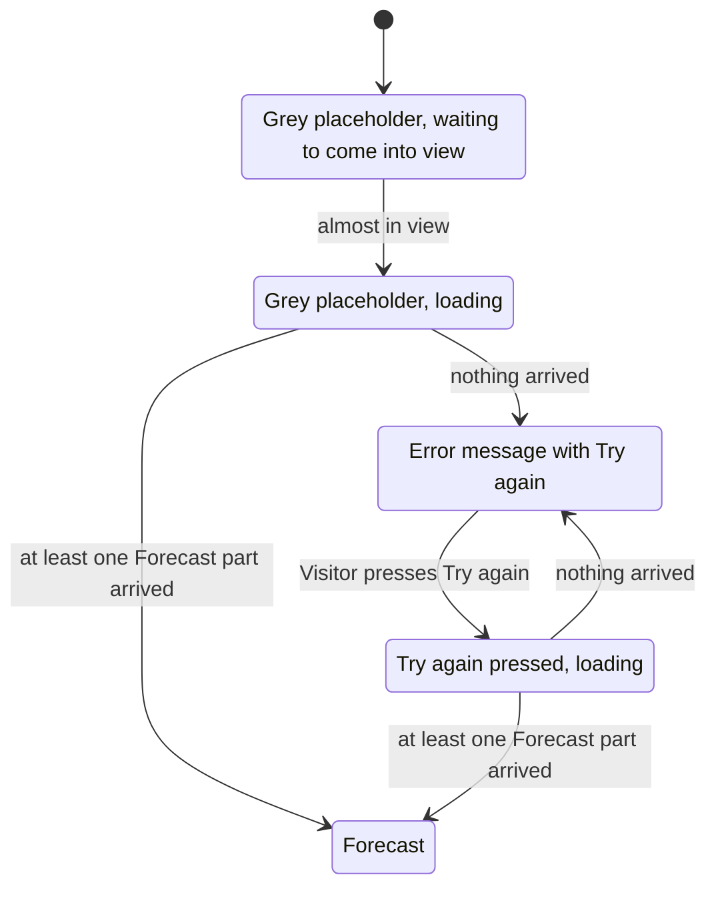
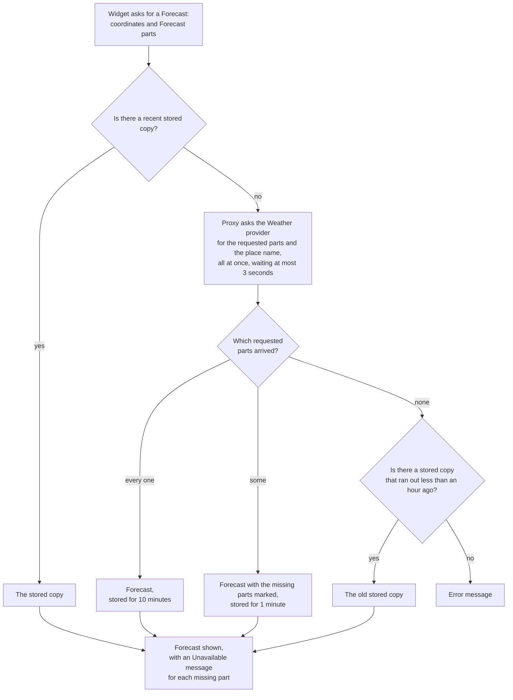
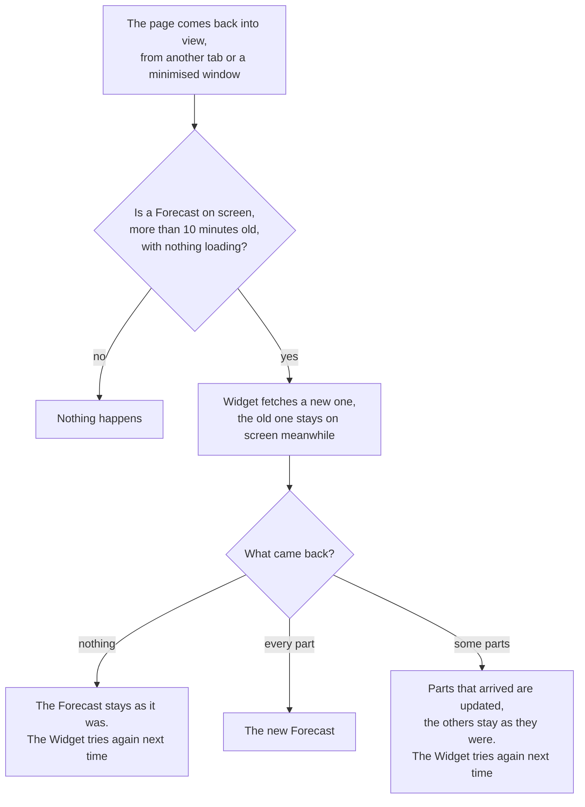
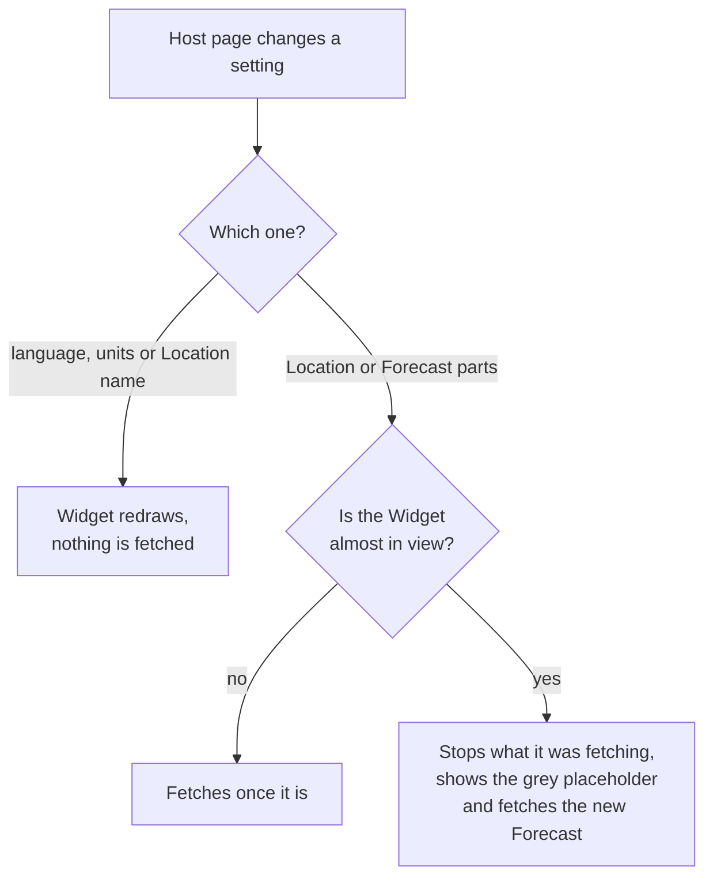
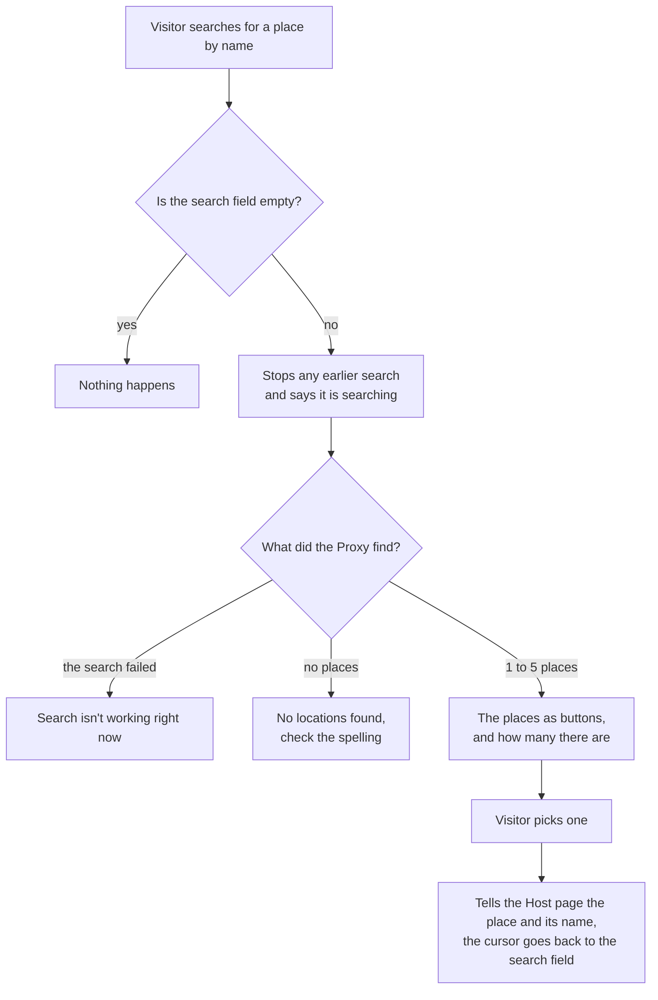
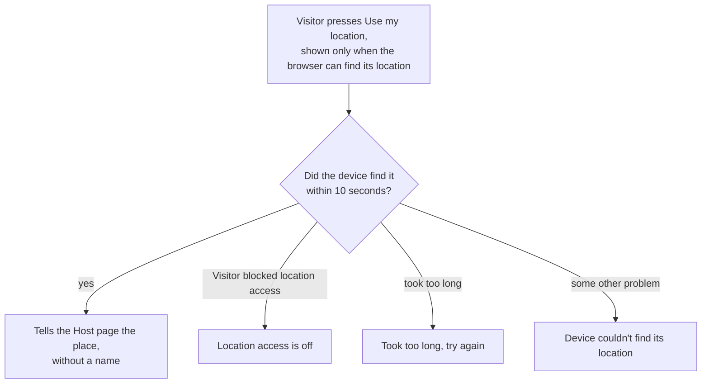

# Scenarios

How the Widget, the Proxy and the Location picker behave in the situations a Visitor runs into. The "For developers" lines point to the code and the tests that prove it.

Words used throughout, as defined in [GLOSSARY.md](../GLOSSARY.md):

- Host page: the web page the Widget sits on. It tells the Widget which Location to show.
- Forecast parts: Current weather, Hourly forecast and Daily forecast. The Host page picks which ones the Widget shows.
- Proxy: our own server. The Widget asks the Proxy for the weather, and the Proxy asks the Weather provider, an outside weather service.
- Stored copy: the network between the Widget and the Proxy keeps a copy of each Forecast for a few minutes, so the next Visitor gets it without the Proxy asking the Weather provider again.

## 1. What the Widget shows

The Widget starts loading once it is within 200 pixels of the visible part of the page, so a Widget further down waits until the Visitor scrolls towards it. The grey outline keeps the page from jumping when the weather arrives. Sections 3 and 4 cover what happens after that.

When Try again works and the Visitor was using the Widget at that moment, the keyboard focus moves to the Location name, so keyboard and screen reader users start reading at the new Forecast.

For developers:

- "Nothing arrived" also covers an answer the Widget can't read and a Proxy that doesn't answer at all.
- A Host page that gives missing or wrong coordinates gets an error message without Try again, since trying again wouldn't help.
- Code: `packages/widget/src/forecast-loader.ts`, `packages/widget/src/weather-widget.ts`
- Tests: `packages/widget/test/loading.test.ts`, `packages/widget/test/error-state.test.ts`

## 2. Fetching a Forecast

A Forecast with every part stays recent for 10 minutes. For 10 minutes after that, the network still hands it out while it fetches a fresh one in the background. A Forecast with missing parts stays recent for 1 minute only, so a short problem at the Weather provider clears up quickly. When the Weather provider sends nothing at all, the network falls back on a stored copy that ran out less than an hour ago, even one with missing parts.

Widgets that use the same Proxy and ask for the same coordinates and Forecast parts share one stored copy. Their language and units don't matter, because the Widget translates and converts the weather itself.

For developers:

- The Proxy rounds coordinates to two decimals before it asks the Weather provider. The Widget sends them unrounded, so 52.0907 and 52.09 are two different stored copies.
- The Proxy answers 400 to invalid coordinates or Forecast parts, which a Widget never sends, and 503 when the Weather provider sends nothing. Neither answer is stored.
- The Widget shows the error message for any answer that lacks a requested part or has none that arrived.
- Code: `packages/proxy/src/proxy.ts`, `packages/proxy/src/weather-provider.ts`, `packages/proxy/src/provider-call.ts`, `packages/widget/src/forecast-client.ts`
- Tests: `packages/proxy/test/forecast.test.ts`, `packages/widget/test/forecast-parts.test.ts`

## 3. The Visitor comes back to the page

The Widget has no timer, so it doesn't use Weather provider calls while nobody is looking. A window that stays visible next to another app never counts as out of sight, and clicking it doesn't update the Forecast either. An update can also bring a stored copy up to 20 minutes old (section 2), so the Forecast doesn't always change.

When the Widget shows Current weather, the Update time at the bottom tells the Visitor when the Weather provider measured it.

For developers:

- The Widget listens for `visibilitychange`. "Tries again next time" happens when a part that was on screen failed to update: the Widget then keeps the old arrival time.
- Code: `packages/widget/src/forecast-loader.ts`, `packages/widget/src/forecast-client.ts`
- Tests: `packages/widget/test/loading.test.ts`, "when the page becomes visible again"

## 4. The Host page changes the Widget

A slow answer to an older question never replaces a newer Forecast.

For developers:

- The settings are the attributes `locale`, `units` and `location-name` (redraw only) and `latitude`, `longitude`, `parts` and `proxy-url` (new fetch).
- When the Host page takes the Widget off the page, it cancels the fetch in progress. If no Forecast was on screen yet, it fetches again when put back (`loading.test.ts`, "fetches again when the Host page moves it while it was loading").
- Code: `packages/widget/src/forecast-loader.ts`
- Tests: `packages/widget/test/weather-widget.test.ts`, `packages/widget/test/loading.test.ts`, `packages/widget/test/locale.test.ts`

## 5. The Location picker

The Visitor can choose a Location in two ways. Both end with the Host page giving the Widget the new coordinates, as in section 4. Screen readers read every message aloud.

### Searching by name

### Using the device's location

The Location picker and the Widget don't know about each other. The Host page decides which Widget gets the chosen Location ([ADR 0002](adr/0002-the-host-page-owns-the-location.md)).

For developers:

- The picker tells the Host page through a `location-select` event. Its `name` is `null` for the device's own location.
- The device may answer with a location it found in the last 5 minutes. The picker rounds it to two decimals.
- Code: `packages/location-picker/src/weather-location-picker.ts`, `packages/location-picker/src/locations-client.ts`, `packages/proxy/src/search-provider.ts`
- Tests: `packages/location-picker/test/search.test.ts`, `packages/location-picker/test/device-location.test.ts`, `packages/proxy/test/locations.test.ts`
